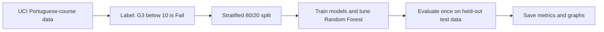

# Student Pass/Fail Prediction

A beginner-friendly Python project that compares a few models for predicting
whether a student passes the Portuguese course.

## Dataset and target

The project uses the official UCI Student Performance Portuguese-course data:
[`data/student-por.csv`](data/student-por.csv), with 649 records.

- Pass: final grade `G3 >= 10` (out of 20)
- Fail: final grade `G3 < 10`
- Input features: `studytime`, `failures`, `absences`, `G1`, and `G2`
- `G1` and `G2` are earlier-period grades; `G3` is never used as an input

The existing root-level `student_performance_real.csv` is not used by the
pipeline.

## Models and evaluation

Run `python main.py`. The script makes a stratified 80/20 train/test split and
compares:

- Majority-class baseline
- Logistic Regression
- Decision Tree
- Random Forest
- Random Forest with a small grid search

The grid search uses five folds from the training split and optimizes F1 for
Fail detection. Final accuracy, Fail precision, recall, and F1 are measured
once on the held-out test split. Focusing on Fail F1 helps avoid relying only on
accuracy when there are fewer Fail examples.

The script saves `reports/model_metrics.csv`, a model-comparison chart, and
confusion matrices under `reports/`.



## Run

Install dependencies and run from the project directory:

```bash
pip install pandas scikit-learn matplotlib
python main.py
```

## Source and limitations

Dataset: Paulo Cortez, *Student Performance*, UCI Machine Learning Repository,
DOI [10.24432/C5TG7T](https://doi.org/10.24432/C5TG7T). Licensed under
[CC BY 4.0](https://creativecommons.org/licenses/by/4.0/).

These records came from two Portuguese schools. Test results are for this
dataset and split; they do not prove that the model generalizes to other
schools or is suitable for high-stakes student decisions.

## Technologies

- Python
- Pandas
- Scikit-learn
- Matplotlib

## Author

Gaurab Aryal
